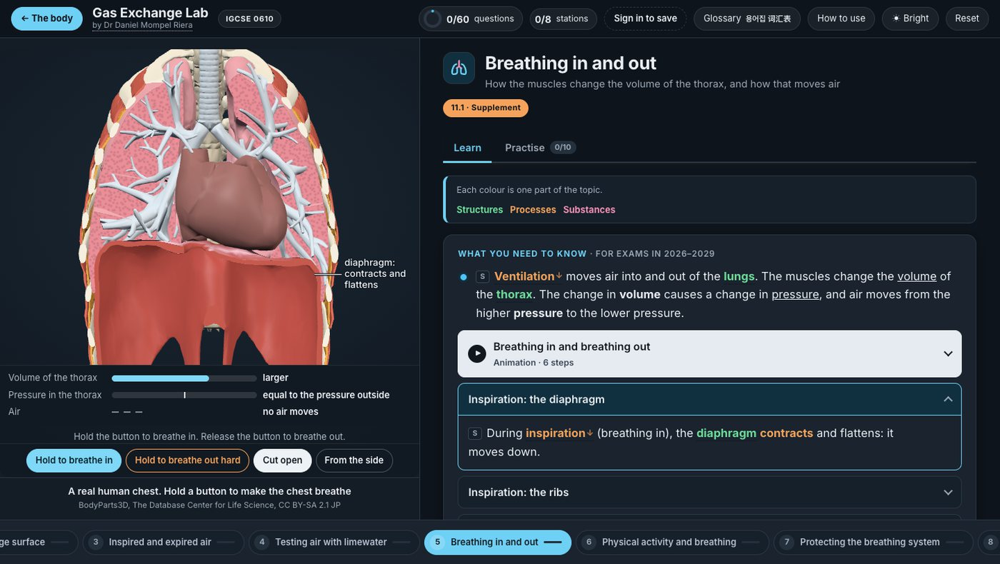

<div align="center">

<h1>🫁 &nbsp;Gas Exchange Lab</h1>

**Cambridge IGCSE Biology 0610 · Topic 11, Gas exchange in humans**

[](https://nlcsbiology.com/gas-exchange-lab/)


by **Dr Daniel Mompel Riera**

</div>



---

## What a student does

Each station has its own picture on the left and short cards on the right that open one at a time. Press a part of the
picture and its card opens; open a card and its part shows in the picture. The stations follow the T11 revision summary,
in its order and in its words. Then the questions say right or wrong, never the answer.

|  |  |
|---|---|
| 🫁 **8 stations** | the breathing system · the gas exchange surface · inspired and expired air · testing air with limewater · breathing in and out · physical activity and breathing · protecting the breathing system · your breathing-rate investigation |
| ✍️ **61 questions** | fill the gaps · multiple choice · put in order · match up · sort into groups · tick a grid · drag the words · press the part on a drawing |
| 🦴 **A real chest in 3D** | the ribs, the external and internal intercostal muscles, the diaphragm, the lungs and the airways of one real body. Turn it, and take off each layer to see what lies under it |
| 🌬️ **Breathe with your finger** | hold a button and the chest breathes in; hold the other and it breathes out hard. Look at the whole chest, the diaphragm or the rib muscles: the muscle fibres become shorter as they contract, beside the white tendon that does not, and the volume, the pressure and the air follow |
| 🫧 **Gases diffusing across the wall** | the blood keeps flowing while oxygen and carbon dioxide molecules move across the wall of an alveolus in both directions, drawn to scale, with the net movement of each gas |
| 🔍 **The surface, feature by feature** | zoom out from one alveolus to both lungs; compare a thin surface with a thick one; see what happens to the gradients when the air stops changing |
| 🧪 **A limewater bench** | breathe in and out through two tubes of limewater and see which one turns cloudy first |
| ❌ **Remember it with X** | Dr Mompel's own diagram to fill in: in e**x**piration, the e**x**ternal intercostal muscles rela**x** |
| 🎬 **Step by step** | a breath of air from the nose to the alveoli; the gases at the wall; what happens to the air in the lungs; breathing in and out; from active muscles to deeper breathing; mucus and cilia at work. Each step waits for “Next step” |
| 📝 **Your investigation** | what to do in the breathing-rate practical and what is marked, with a link from each part of the report to the place in the [Write-Up Lab](https://nlcsbiology.com/write-up-lab/) where you practise it. The lab never does the work for you |
| 📖 **A shared glossary** | one wording per term, the same in every lab; press 한국어, 中文 or 日本語 to see each word's name in Korean, Chinese or Japanese (the definitions stay in English) |

> [!NOTE]
> **The right answers are stored only as scrambled fingerprints.** The lab can tell a student they are wrong, but its
> questions cannot show what *right* is. The explanations of the multiple-choice options are published with the lab,
> scrambled, for the pupils whose teacher gives them the Accommodation: each sees an explanation after a second wrong try.
> Someone who unscrambles them could learn an answer.

## Where it sits

Behind [The human body](https://nlcsbiology.com/human-body-hub/) shelf (Topic 11), one shelf of the
[Biology Hub](https://nlcsbiology.com/biology-hub/) — the front door to every Biology app here. The **← The body** button
goes back up. The heart and the blood are in the [Circulation Lab](https://nlcsbiology.com/circulation-lab/), and mucus
and cilia as a defence against disease are in the [Immunity Lab](https://nlcsbiology.com/immunity-lab/#defences).

<details>
<summary><b>Behind the scenes</b> — how this lab works, in plain English</summary>

<br>

**Real pictures.** The chest is one real human body, measured by medical scanners and published as BodyParts3D. What
moves in it is worked out from its bones: each rib turns about its own joint with the spine, so the upper ribs lift like a
pump handle and the lower ribs like a bucket handle, and the pressure and the air follow from the change in volume. The
breathing system, the alveoli and the lining of the trachea are drawn by Servier Medical Art (CC BY 4.0). Every label is
one straight, level line that ends on its part, and no two lines cross. Pressing a name lights the exact outline
of that part, traced from the drawing itself, and dims the rest.

**Why the right answers are not in the page.** Each question carries a *scrambled fingerprint* of its answer. When a
student answers, the page scrambles what they did in the same way and compares the two. Scrambling only works one way, so
no fingerprint can say what the right answer is — only *not that one*. The real answers live in one file that is never
published.

**The answers for teachers.** `js/data/answers.lock.json` holds this lab's answers and explanations, **locked** (AES-256
encryption). The lab's pages never load it. Only the Biology Hub's teacher page opens it, when a teacher presses **Show the
answers** on Homework analysis, with a key kept in the labs script's settings and on the author's computer, never in this
repository. Without that key the file cannot be read. How it works, and what it means for a school running its own copy:
the Biology Hub's README, *Teacher mode, and the teacher page*.

**What is shared with the other labs.** The question engine, the marking, the saving, the sign-in, the widgets and the
glossary are kept in one place and copied in whenever a lab is rebuilt, so a fix reaches every lab at once. What belongs
to this lab alone is its content and its pictures.

**Rebuilding it** (only needed if you change the content). One command reads the master file with the answers in it and
writes out the published version with only the fingerprints. It refuses to finish unless every answer still marks
correctly. The `tools/` named here stay on Daniel's computer: they are not in this repository.

```
node tools/build.mjs
```

Picture credits: [`assets/photos/CREDITS.md`](assets/photos/CREDITS.md). The 3D chest: [`assets/3d/CREDITS.md`](assets/3d/CREDITS.md).

Pronunciation: the 🔊 UK and 🔊 US buttons beside the hard words play the Cambridge Dictionary's own recordings from its website (© Cambridge University Press & Assessment; nothing of theirs is stored here), with Wikimedia Commons recordings as the backup: [`assets/say/CREDITS.md`](assets/say/CREDITS.md).

</details>

Made by **Dr Daniel Mompel Riera** ·
[dmompelriera@nlcsjeju.kr](mailto:dmompelriera@nlcsjeju.kr)

## Licence

| What | Licence |
|---|---|
| **The software** — everything that runs: JavaScript, HTML structure, CSS, build tools | [AGPL-3.0](LICENSE) |
| **The teaching material** — question text, explanations, diagrams and images I made, wherever they are stored | [CC BY-NC-SA 4.0](LICENSE-CONTENT) |

**In plain English.** Use it, change it, run it for your students — free, and you never need to ask. If you change the
software and let anyone else use it, *including over a network*, you have to publish your source under the same licence.
You may not sell the teaching material or use it commercially, and the credit has to stay.

**Not covered:** third-party images, 3D models and media keep their own licences — see the picture credits.

© 2026 Dr Daniel Mompel Riera. I hold the copyright, so I can grant other terms: if you want to use any of this
commercially, ask me at <dmompelriera@nlcsjeju.kr>.
